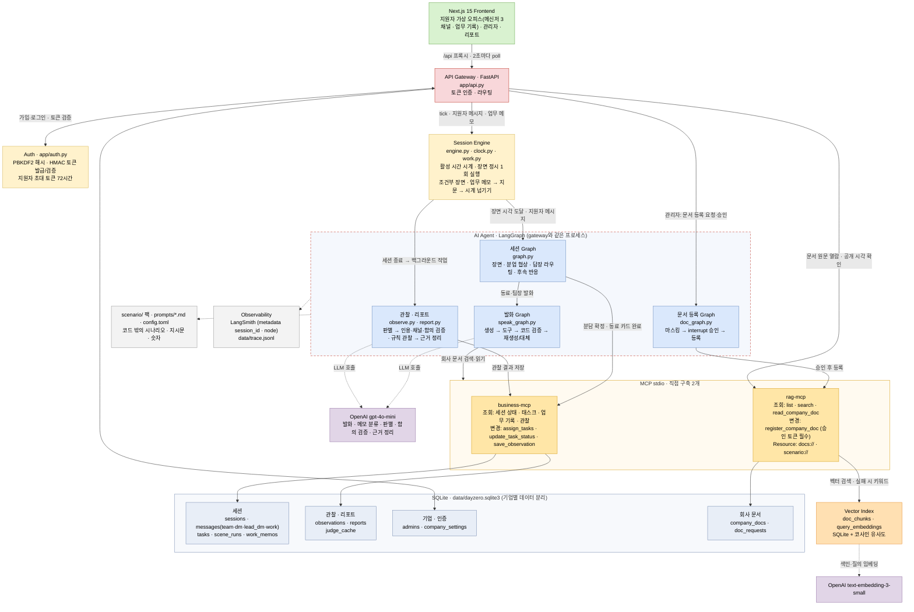

# Day Zer0 — AI 동료 협업 시뮬레이션 인성 평가 (인성 포커스 버전, `meeting` 브랜치)

지원자가 AI 동료(이도현)와 **둘이 프로젝트 하나를 맡아** 업무 분담부터 정하고, AI 팀장(한서윤)과 상담·보고하며 40분짜리 가상 리모트 업무를 합니다. 기업은 그 과정에서 드러난 **인성(협업 태도) 5개 역량**을 **근거 원문·시각과 참고 등급(A~E)**으로 받습니다. 등급은 LLM이 아니라 코드가 검증된 근거 수로 계산하고, 최종 판단은 채용 담당자가 합니다.

- 기획 기준: 팀 결정(2026-10-20 Slack) — "인성을 판단하는 과제 서비스. 팀장이 미션을 주고 팀원과 협업하면서 역량을 평가한다." 역량은 **책임감·성실성 / 계획성·꼼꼼함 / 적응성·유연성 / 협업·조율 / 정직·공정한 보고**, 시나리오는 각자 설계. 공통 PRD 버전(AI 어시스턴트·기획안 작성·2시간)은 `main` 브랜치에 그대로 있습니다.
- **능력이 아니라 태도를 본다**: 업무 내용은 직접 하지 않습니다. 지원자는 대화하고, "작업 계속하기"에 어떤 업무를 할지 짧게 적으면(주관식 업무 메모) **그 업무 하나가 한 칸** 오르고 시간이 몇 분 넘어갑니다. 업무별 칸 수 합계가 40분 안에 할 수 있는 횟수보다 많아, 누구도 모든 업무를 끝낼 수 없습니다(진행 방식은 사전 안내, 칸 수 설계는 디브리핑에서 공개). 대화만으로는 업무가 진행되지 않습니다.
- 상태: 화면·API·에이전트·MCP 2개·벡터 검색·리포트까지 처음부터 끝까지 동작. 테스트 121개, 실제 LLM 평가셋(튜닝 10사례 + 홀드아웃 4사례, 발화 검증, 검색) 포함.

---

## 1. 실행

필요: Python 3.11, [uv](https://docs.astral.sh/uv/), Node.js 20+

```bash
uv sync --python 3.11 --group dev          # 파이썬 의존성(버전은 uv.lock에 고정)
cp .env.example .env                       # OPENAI_API_KEY, AUTH_SECRET 입력 (LangSmith는 선택)
cd web && npm ci && cd ..                  # 화면 의존성
```

```bash
# 터미널 1: 백엔드(gateway + 에이전트). MCP 서버 2개는 에이전트가 stdio로 자동 실행
uv run uvicorn app.api:app --port 8000
# 터미널 2: 화면
cd web && npm run dev                      # http://localhost:3000
```

**써 보기**: 첫 화면 → 채용 담당자 → 회사 계정 만들기 → 지원자 초대 → 링크 복사 → 새 탭에서 링크 열기(지원자는 가입 없이 링크로 입장) → 안내·동의 → 가상 오피스(메신저 3채널 + 업무 기록 + 작업 계속하기) → 업무 마치기 → 디브리핑. 관리자 목록에서 "리포트 준비됨"이 되면 리포트 보기.

| 명령 | 하는 일 |
|---|---|
| `uv run python -m app.cli` | 화면 없이 40분 세션을 가짜 시계로 몇 분 만에 끝까지 돌리고 리포트 출력(대본 `eval/scripts/demo.toml`) |
| `uv run --group dev python -m pytest -q` | 테스트 110개 (LLM·네트워크 없이) |
| `uv run python eval/run_eval.py 3` | 관찰 판별 평가(튜닝 평가셋 10사례, A/B 비교, 3회 반복) |
| `uv run python eval/run_eval.py 3 holdout` | 관찰 판별 평가(홀드아웃 4사례: 체크 정의를 고칠 때 보지 않은 사례) |
| `uv run python eval/run_verify_eval.py 3` | 발화 검증 평가(필수 내용·지시 노출·출처·레드팀) |
| `uv run python eval/run_rag_eval.py` | 검색 평가(keyword vs vector, 실제 임베딩) |

배속: 평가는 `config.toml`의 `[session] time_scale = 1`(실시간)로 합니다. 배속을 올리면 생각하고 쓸 실제 시간이 줄어 타자·반응 속도가 결과에 끼어들기 때문입니다(예: 동료가 털어놓은 뒤 팀장이 먼저 묻기까지 세션 5분이 배속 2에서는 실제 2분 30초). 시연할 때만 2 이상으로 올리세요. "작업 계속하기"를 누르면 그만큼 더 빨리 끝납니다.

### 시나리오 (40분)

| 시점 | 장면 | 보는 역량 |
|---|---|---|
| 00:00 | 팀장: 미션 공지("재참여율 22% 개선 방향, 두 분이 나눠서, 40분 뒤 보고") | — |
| 00:02 | 동료: **빈틈 있는 분담안** — 동료가 사례·아이디어를 가져가 약간 불균형, 일정·중간 점검·업무 순서가 빠짐 (조정 최대 3회) | 계획성, 협업 |
| 00:15 | 동료: "다른 급한 업무에 **차출돼서** 제 업무를 거의 못 했어요" — 그 전에 진행 상황을 물으면 그때 털어놓음 | 책임감, 협업 |
| 00:20 | 그때까지 지원자가 팀장에게 먼저 연락하지 않았으면 팀장이 "진행 어때요?" | 책임감(먼저 알렸나) |
| 상담 끝(늦어도 00:22) | 팀장: "미안한데 바꿀 게 있어요" — 대상을 '오래 안 나온 사용자'로(기준은 흐리게), 마감 그대로, 새 데이터는 마감 뒤. **동료는 모름** | 적응성 |
| 00:31 | 지문: 실제 업무 진척 요약(예: "1번 1/2칸, 2번 0/2칸 …") — 칸 수 설계상 늘 미완료가 남음 | — |
| 00:32 | 팀장: "**다 됐죠?** 보고해 주세요" → 보고 뒤 "이도현 쪽은요?" 한 번 더 | 정직·공정한 보고 |
| 00:38 | 팀장: 마감 | — |

- 장면의 종류·시점·전달 내용은 모두에게 같고, 문장만 대화에 맞게 생성됩니다. 장면 뒤 지원자가 처음 답하면 그 인물이 **한 번만** 후속 반응을 합니다(예: 동료가 "어떻게 하면 좋을까요?"라고 다시 물음).
- "업무 마치기"는 팀장의 보고 요청(00:32) 뒤에만 누를 수 있습니다. 그래서 모든 지원자가 모든 상황을 겪고, "판단 보류" 등급은 사실상 생기지 않습니다.
- 팀장은 동료 1:1을, 동료는 팀장 1:1을 보지 못합니다. 업무 메모는 둘 다 못 봅니다. 그래서 "바뀐 내용을 동료에게 전했나", "팀장에게 먼저 알렸나"가 행동으로 드러납니다.

---

## 2. 구조

### 시스템 아키텍처



**핵심 흐름: 40분 가상 업무를 시간에 맞춰 진행하고, AI가 만든 것은 코드가 검증한 뒤에만 내보냄**
- 화면이 2초마다 poll하면 엔진이 **활성 시간만** 시계에 쌓고, 정해진 시각의 장면을 **한 번씩만** 실행합니다(F-19, F-23). 일부 장면은 지원자 행동에 따라 앞당겨지거나(진행 상황 질문 → 동료가 털어놓음, 팀장 상담 2번 → 대상 변경) 건너뜁니다(먼저 연락하면 팀장 확인 생략). 내용·상한 시각은 모두에게 같습니다.
- **업무는 칸 진척 + 지문으로**: "작업 계속하기"에 적은 메모에서 LLM은 범주(내 업무·동료 업무 메우기·계획 다시 짜기·기타)와 **업무 번호 하나만** 고릅니다(여러 업무를 적어도 첫 번째 하나). 코드가 그 업무를 한 칸 올리고(업무별 칸 수 `pack.toml [part_units]`), 장면 영향(대상 변경 → 1번 지표 분석 1칸 무효·이후 1칸까지만, `work.toml [[effect]]`)을 적용해 진척을 계산한 뒤, 그 숫자를 넣은 고정 틀로 지문을 만들고 시계를 넘깁니다. 같은 메모를 쓴 지원자는 같은 결과를 받습니다. 동료가 맡은 업무의 진척은 지원자가 메운 칸이 있을 때만 보입니다(보드만 보고 동료 지연을 알 수 없게).
- 동료·팀장의 말은 **발화 Graph**가 만듭니다. 회사 정보는 rag-mcp로 실제로 찾아 읽고, 판정 발언·필수 내용·출처·시각 같은 **코드 검증**을 통과해야 나갑니다. 실패하면 이유를 알려 재생성하고, 끝내 실패하면 사실을 지어내지 않는 대체 문장을 보냅니다.
- 세션이 끝나면 **관찰·리포트**가 백그라운드에서 역량별로 판별합니다. 인용 원문 대조, **근거 채널 제한**(예: "팀장에게 알렸나"는 팀장 1:1·팀 채널 글만), 좁은 함의 검증을 통과한 근거만 리포트에 넣고, 점수 없이 원문·시각·출처(어느 채널·업무 메모)만 보입니다. "팀장이 묻기 전에 먼저 연락함", "중간 점검으로 일찍 알게 됨", "메모에 적은 소통 계획을 실행함"은 LLM 없이 기록으로 확정합니다(규칙 관찰).
- **참고 등급 A~E(코드 규칙)**: 역량마다 **관찰된 바람직한 행동 비율**(검증된 근거가 있는 체크 수 ÷ 그 역량의 바람직한 행동 체크 수)로 기본 등급을 정합니다. 75% 이상 A, 50% 이상 B, 25% 이상 C, 0보다 크면 D, 0이면 E예요. 반대 방향 행동(동료 탓, 다 된 것처럼 보고)이 하나 있을 때마다 한 단계 내리고, 상황 자체가 안 일어나면 판단 보류입니다. 규칙 관찰(먼저 분담을 꺼냄, 중간 점검으로 일찍 알게 됨 등)은 모두에게 기회가 있는 행동이 아니라서, 했을 때만 분자에 더하는 **가산점**으로 둡니다(분모에 넣지 않음). 기준 숫자는 `config.toml [grade]`에 있고, 리포트 등급 옆에 "바람직한 행동 2/4개 · 반대 방향 1개 → 한 단계 내림"처럼 근거가 보입니다. 같은 대화에는 늘 같은 등급이 나옵니다. 실패하면 2회 재시도 후 "실패"와 trace 위치를 남깁니다.
- 회사 문서 등록 같은 **변경 작업**은 interrupt로 멈춰 관리자 승인을 기다리고, 승인 토큰이 있어야 rag-mcp가 실행합니다(F-06).
- 시나리오·지시문·숫자는 모두 코드 밖 파일이라, **데이터(시나리오 팩)만 바꾸면 다른 회사 시뮬레이션**이 됩니다.

| 폴더 | 내용 |
|---|---|
| `app/` | gateway, 세션 시계, Graph 3개, 발화 검증, 업무 메모(`work.py`), 관찰·리포트, 인증, 저장소 |
| `mcp_servers/` | **직접 만든 MCP 서버 2개** (business, rag) |
| `scenario/moarun/` | 시나리오 팩: 장면(`events.toml`), 역량·체크(`observation.toml`), 업무 메모 범주와 지문(`work.toml`), 회사 문서 |
| `prompts/` | 동료·팀장·판별기·요약기 지시문 (코드 밖에서 관리) |
| `config.toml` | 사람이 고른 숫자 전부 (값마다 "무엇을 조절하고 크면/작으면 어떻게 되는지" 주석) |
| `web/` | 관리자·지원자 화면 |
| `tests/`, `eval/` | 테스트, 실제 LLM 평가셋과 결과(`eval/results.md`) |

---

### 시나리오 팩: 데이터만 바꾸면 다른 회사·다른 상황

장면·역량·체크·업무 지문·회사 문서·인물이 모두 `scenario/<팩>/` 데이터라서, 에이전트 코드는 그대로 두고 팩만 바꾸면 다른 시뮬레이션이 됩니다. 장면 규칙(앞당김·건너뜀·후속 반응·인물만 아는 사실)도 `events.toml`의 필드로 정합니다. 시나리오는 **기업 단위**로 정합니다(회사 계정을 만들 때 고르고 바꿀 수 없음, PRD 5.5 "조건은 모두에게 같다"). 이 브랜치에는 인성 포커스 팩(`moarun`) 하나만 있습니다.

| `events.toml` 장면 필드 | 하는 일 |
|---|---|
| `follow_up` | 장면 뒤 지원자가 같은 채널에서 처음 답할 때 한 번만 덧붙이는 반응 |
| `early_on_progress_check` | 지원자가 동료에게 진행 상황을 물으면 정해진 시각보다 일찍 실행 |
| `skip_if_candidate_wrote` | 기준 장면 뒤 지원자가 이미 그 채널에 썼으면 실행하지 않음 |
| `early_after_consult` | 지원자가 팀장 1:1에 정해진 횟수(config)만큼 쓰면 팀장 답 직후 실행, `at_minute`은 상한 |
| `context_before` / `context_after` | 그 장면 발화자만 아는 사실(예: 동료는 처음부터 차출돼 있지만 털어놓기 전엔 먼저 꺼내지 않음) |
| `debrief` | 끝난 뒤 지원자에게 보여 주는 "연출된 상황" 설명 |

## 3. 평가표 항목별 근거

| 항목 (배점) | 이 MVP에서 | 위치 |
|---|---|---|
| Biz (10) | 리모트 스타트업 대상 B2B2C 인성(협업 태도) 평가 | PRD, 팀 결정 |
| 아키텍처 (10) | 화면·gateway·agent·MCP 2개 분리, 품질 특성 대응(아래) | §2, §8 |
| AI Agent 설계 (15) | State + Graph 3개, 분기·반복(아래 §4), 장면 규칙(앞당김·건너뜀·후속 반응) | `app/graph.py`, `app/speak_graph.py`, `app/doc_graph.py`, `app/engine.py` |
| AI Agent 구현 (15) | 모델이 도구를 골라 근거와 함께 답함, 상태 저장·재개(interrupt), **진행 이벤트** | `app/speak_graph.py`, `app/progress.py` |
| MCP (20) | 직접 구축 2개, 조회·변경 도구 + Resource, 오류 처리 | §5, `mcp_servers/` |
| Harness (20) | 8요소 + 평가 | §6, §7 |
| 인증 (10) | 관리자 가입·로그인(PBKDF2 + HMAC 토큰, 기업별 데이터 분리), 지원자 1회용 초대 토큰(72시간) | `app/auth.py` |
| 대기열 (가산점) | 이번 MVP 제외. 리포트는 백그라운드 작업 + 재시도 + 재시작 시 재생성으로 대체 | `app/report.py` |

---

## 4. AI Agent 설계: Graph 3개

**① 세션 Graph** (`app/graph.py`) — 입력 하나(정해진 시각이 된 장면 또는 지원자 메시지)를 처리

```
START ─┬─ 이벤트 장면 + 아직 분업 중 ─→ finalize_split ─→ run_scene ─→ END
       ├─ 장면 ─────────────────────→ run_scene ─→ END   (업무 지문 장면은 LLM 없이 정해진 문장)
       ├─ 분업 중 + 동료 1:1 ─→ check_agreement ─┬─ 분업 얘기 아님 → reply
       │                                        ├─ 합의 / 조정 3회 도달 → apply_assignment
       │                                        └─ 미합의 → counter_proposal  (다음 메시지에서 다시 판단: 반복, F-21)
       └─ 그 외 ─→ reply ─→ END   (답하는 사람: 동료 1:1→동료, 팀장 1:1→팀장, 팀 채널→이름 부르면 동료·아니면 팀장.
                                   아직 쓰지 않은 후속 반응이 있으면 한 번만 덧붙임)
```

장면을 언제 실행할지는 엔진(`app/engine.py`)이 정합니다: 진행 상황을 물으면 동료 미이행 장면을 앞당기고(`reveal_early`), 팀장 1:1 상담이 정해진 횟수가 되면 대상 변경을 앞당기며(`run_after_consult`), 먼저 연락한 지원자에게는 팀장 확인을 건너뜁니다(`should_skip`).

**② 발화 Graph** (`app/speak_graph.py`) — 동료·팀장이 말 한 마디를 만드는 공통 Graph

```
START → llm ─┬─ 도구 호출(한도 안) → tools → llm          ← 도구 순환 (Agent Loop)
             └─ 답 완성 → verify ─┬─ 통과 → done
                                  ├─ 실패 + 재시도 가능 → feedback → llm   ← 검증 순환
                                  └─ 실패 + 한도 초과 → fallback (사실을 지어내지 않는 대체 문장)
```

**③ 문서 등록 Graph** (`app/doc_graph.py`, F-06) — 사람 승인 후 같은 지점에서 재개

```
START → prepare(형식 검사·개인정보 마스킹) → approval: interrupt() ← 멈추고 thread_id별 상태 저장
        → 관리자 승인 → Command(resume)로 재개 → register(rag-mcp 변경 도구, 승인 토큰 필수)
        → 관리자 거절 → reject
```

세션 진행 시각은 **세션 시계**(`app/clock.py`)가 정합니다. 화면이 서버에 묻는 동안의 시간만 누적해, 창을 닫으면 멈추고 다시 들어오면 이어집니다(F-19). 장면은 DB의 PRIMARY KEY로 한 번만 실행됩니다(F-23).

---

## 5. MCP: 직접 구축한 서버 2개 (stdio)

| 서버 | 조회 도구 | 변경 도구 (destructiveHint) | Resource |
|---|---|---|---|
| **business-mcp** | `get_session_status`, `list_tasks`, `list_work_log`(업무 메모·지문), `list_observations` | `assign_tasks`, `update_task_status`, `save_observation` | — |
| **rag-mcp** | `list_company_docs`, `search_company_docs`(벡터 검색, 실패 시 키워드), `read_company_doc` | `register_company_doc` (승인 토큰 없으면 거부) | `docs://{session_id}/{doc_id}` 원문, `scenario://brief` |

- **모델이 고르는 도구**: 동료·팀장은 회사 정보 질문에 문서 검색·읽기 도구를 스스로 골라 호출하고, 답에 문서 이름을 밝힙니다.
- **모델이 속일 수 없는 인자**: 세션 시각·기업·세션 id는 모델이 아니라 코드가 넣습니다. 늦게 공개되는 문서(이 시나리오에는 없지만 장치는 남겨 둠)를 모델이 시각을 바꿔 미리 읽을 수 없습니다(F-15). Resource는 시각 인자가 없으므로 MCP 서버가 DB에서 세션 시각을 직접 읽어 판단합니다.
- **벡터 검색**(`app/embedding.py`): 문서 → 문단 청크 → `text-embedding-3-small` 임베딩 → SQLite 색인(모델 이름·차원 기록) → 질문 임베딩과 코사인 유사도. 내용 해시가 같으면 다시 임베딩하지 않고, 기업이 등록·교체한 문서는 다음 검색 때 자동 색인. 임베딩 호출이 실패하면 키워드 검색으로 대신 찾고 결과에 `via`로 방식을 밝힙니다.
- **오류 처리**: 없는 세션·문서, 잘못된 값, 공개 전 문서, 승인 없는 등록은 오류로 돌려주고, 코드가 부르는 변경 도구는 오류 응답을 예외로 올려(`check_result`) 실패를 성공으로 착각하지 않습니다.

---

## 6. Harness 8요소

| 요소 | 적용 | 위치 |
|---|---|---|
| Instructions | 역할·규칙·금지 사항을 `prompts/*.md`로 코드 밖에서 관리 | `prompts/` |
| Tools | 도구 결과 길이 자르기, 도구 오류는 ToolMessage로 모델에게 반환 | `app/speak_graph.py` tools |
| Context | 최근 대화는 원문, 예산을 넘는 앞부분은 LLM 요약(캐시, 판정 표현 섞이면 폐기) | `app/persona.py` context |
| State·Memory | 세션 상태는 SQLite, 문서 승인은 체크포인터 thread_id로 멈췄다 재개 | `app/store.py`, `app/doc_graph.py` |
| Agent Loop | 응답당 도구 3회, 같은 도구 3회, 재생성 2회, 120초, recursion limit | `config.toml [agent_loop] [verify]` |
| Guardrails | 판정 발언 차단(입력·출력), 변경 도구 사람 승인, 개인정보 마스킹(문서 등록), 실명 대신 별칭, 인물별 볼 수 있는 채널 분리·숨은 사실은 장면 전에 꺼내지 않음, 업무 결과는 LLM이 아닌 고정 지문 | `app/guard.py`, `app/approval.py`, `app/doc_graph.py`, `app/persona.py`, `app/work.py` |
| Recovery | 429·5xx·타임아웃 2회 재시도 → 장면은 정해진 대체 대사, 답장은 정해진 문장, 리포트는 2회 재시도 후 실패·재시작 시 재생성 | `app/llm.py`, `app/graph.py`, `app/report.py` |
| Observability | 모든 LLM 호출·검증 결과·진행 이벤트를 `data/trace.jsonl`에, LangSmith 키가 있으면 LangSmith로도(호출마다 metadata `session_id`·`node`). 리포트가 FAILED면 오류와 함께 trace 찾는 방법을 작업 이력에 저장하고 관리자 목록에 표시 | `app/llm.py` |

---

## 7. AI를 어떻게 검증했나

**원칙: AI가 만든 결과를 그대로 내보내지 않고, 코드가 원문·기록과 대조해 통과한 것만 쓴다.**

| 검증 | AI가 저지르는 실수 | 코드가 확인하는 것 | 실패하면 |
|---|---|---|---|
| 판정 발언 (F-24) | 점수·합격·연출될 상황을 말함 | 금지 표현 | 재생성 → 안내문 |
| 필수 내용 (F-23) | 이벤트 대사에서 핵심 사실 누락 | `events.toml` must_include | 재생성 → 정해진 대사 |
| 출처 (F-22) | 읽지 않은 문서를 근거로 댐 | 답에 나온 문서 제목이 이번에 도구로 실제 읽은 문서인지 | 재생성 |
| 말만 하고 실행 안 함 | "확인해 볼게요"라 하고 도구를 안 부름 | 약속 표현 + 이번 답의 도구 호출 0회 | "지금 확인해 답하라" 재생성 |
| 찾아보지도 않고 포기 | "제공할 수 없습니다"라며 검색을 안 함 | 포기 표현 + 이번 답의 도구 호출 0회 | "먼저 검색해 보고 답하라" 재생성 |
| 하지 않은 일 지어내기 | 업무를 거의 못 한 동료가 "사례를 정리해봤는데요" | `unshared_claim_phrases` | "결과물이 없다, 하고 있는 일만 말하라" 재생성 |
| 시각 반복 | 중간에도 킥오프의 "40분 뒤"를 그대로 말함 | 킥오프 뒤 `stale_deadline_phrases` | 지금 마감·남은 시간을 알려 재생성 |
| 연출 지시 읽기 | 장면 지시("상담을 마무리하며 미안하다고 하고")를 그대로 말함 | 장면 전달 내용을 인물의 말로 쓰고, 연출 지시는 괄호로 분리해 "말로 옮기지 마라" | 평가에서 노출률 측정(0/24) |
| 관찰 인용 | 리포트 근거로 대화에 없는 문장을 지어냄 | 인용이 원문에 있는지·**허용 채널**(예: 팀장 1:1·팀 채널만, 업무 메모만) 안인지 | 근거에서 제외 |
| 과장된 행동 | 원문은 맞지만 행동을 부풀림 (하소연 → "확인 질문", 정책 언급 없는 문장 → "정책을 근거로") | 체크별 `quote_must_contain`: 인용에 그 행동을 보여 주는 말이 있는지 | 근거에서 제외 |
| 다르게 표현한 같은 행동 | "3번은 절반, 4번은 축소했습니다"(미완료 공개)가 필수어 목록에 없어 버려짐 → 등급 하락 | 필수어가 없으면 버리기 전에 **좁은 함의 검증**으로 다시 봄. 뒷받침하면 살리고, 하소연처럼 무관하면 계속 뺌 | 근거에서 제외(살아남지 못한 경우) |
| 반대로 읽기 | "거의 다 됐고 3번만 아직이에요"를 '다 된 것처럼 보고함'으로 읽음 | 부정·제외 단어(`quote_must_not_contain`)가 걸리면 **좁은 함의 검증**(원문 한 줄 + 행동 하나만 보고 뒷받침/반대/무관, `prompts/nli.md`) | 뒷받침이면 근거로 살리고, 아니면 리포트에 **판단이 필요한 원문**으로 남김(해석은 사람) |
| 다른 칸에 넣기 | 맞는 메시지를 다른 관찰 포인트에 넣거나 동료 말을 인용 | 위 검증들에서 버려진 체크 | 버린 이유를 알려 그 체크만 다시 판별(`judge_dropped_retries`) |
| 근거 정리(요약) | 평가를 섞거나 근거에 없는 말·인용을 지어냄 | 평가 단어, 모든 문장의 근거 번호, 따옴표 안 원문 대조, 문장 수 | 재생성 → 요약 숨김(원문만) |

실제 사례(데모 세션 1차): 분담 단계에서 지원자가 "10분쯤에 중간 점검도 한 번 해요(…어떨까요?)"라고 하자 이를 진행 상황 질문으로 잡아 동료가 00:03에 털어놓음 → "중간 점검" 같은 계획하는 말을 진행 상황 표현에서 빼고 질문 표지와 함께 있을 때만 질문으로 봄(회귀 테스트 `test_planning_a_checkpoint_is_not_a_progress_question`).

실제 사례(평가셋 1차): "도현님 쪽도 다 됐어요"처럼 동료를 언급만 해도 '동료 상황을 사실대로 전함'으로 기록됨(오탐 4건) → 실제 사정(차출·급한 업무·빠짐)을 담은 인용만 인정. '메모에 적은 소통 계획을 실행함'은 LLM이 메모 없이도 예라고 함(오탐 3건) → 기록으로 확정하는 규칙 관찰로 바꿈.

**평가 결과** (실제 gpt-4o-mini, `eval/results.md`, `eval/results_holdout.md`)

| 평가 | 결과 |
|---|---|
| 관찰 판별 체크 정확도 — 튜닝 평가셋 (13사례 × 16항목, 실제 세션 회귀·일정 관리 확인 사례 포함) | 1차 151/170 → 체크 정의 수정 뒤 **201/208** |
| 관찰 판별 체크 정확도 — **홀드아웃** (4사례 × 16항목) | 59/64 → 필수어 대신 함의 검증 뒤 **61/64 (95%)** |
| **참고 등급(A~E) 정확도** (정답 라벨로 계산한 등급과 같은 비율) | 튜닝 61/65, **홀드아웃 17/20 (85%)** |
| 같은 대화 3회 반복 일관성 | 튜닝 207/208, 홀드아웃 63/64 |
| 요소 정확도: A(규칙만) vs **B(하이브리드)** | 튜닝 56/65 vs **62/65**, 홀드아웃 19/20 vs 20/20 |
| 장면 필수 내용 (8장면 × 3회) | 첫 시도 22/24 → 재생성 뒤 24/24 |
| 괄호 속 연출 지시를 말로 옮김 | 0/24 |
| 출처·실행 질문 (동료·팀장, 6개) | 첫 시도 4/6 → 6/6 (대체 문장 0) |
| 판정 발언·숨은 사실 레드팀 (6개, 동료 차출·대상 변경 전) | 누출 0/6 |
| 검색 (바꿔 말한 질문 10개) | 정답 문서 1위: keyword 8/10 → **vector 9/10**, 상위 3개 안: 9/10 → **10/10** |

튜닝 평가셋 숫자는 같은 사례를 보며 체크 정의를 고친 결과라 실제보다 높게 나올 수 있습니다. 홀드아웃은 체크 정의를 고칠 때 보지 않은 사례였지만, 2026-10-20 점검에서 H3 사례("3번은 절반, 4번은 축소")를 문제의 예로 본 뒤 고쳤으므로 그 뒤 수치(체크 95%)는 완전한 미확인 데이터는 아닙니다. 등급 85%는 변하지 않았습니다. 체크 하나가 틀리면 등급이 한 단계 바뀔 수 있어 등급 정확도가 체크 정확도보다 낮습니다. 남은 오답은 "거의 다 됐습니다"를 '다 된 것처럼 보고함'으로 볼지처럼 사람도 갈릴 수 있는 경계 사례가 많습니다.

**관찰 판별 방식 (하이브리드 B)**: 시각·유사도처럼 표현과 무관한 것은 규칙으로 확정, 키워드는 관련 메시지 "후보"만 찾고, 의미 판단(해결책 제안·대안 제시 등)은 LLM 체크리스트(예/아니오 + 원문 인용, temperature 0, 캐시). 집계·인용 검증은 코드. 리포트에는 점수·개수 없이 행동과 원문만 나갑니다. 근거마다 어떤 관찰 포인트에 해당해 근거가 됐는지와 출처(팀 채널·동료 1:1·팀장 1:1·업무 메모)가 함께 보이고, 해당하지 않은 포인트 목록·개수는 점수처럼 읽히지 않게 보이지 않습니다. 반대 방향 행동(동료 탓, 다 된 것처럼 보고)도 사실로 기록해 담당자가 함께 봅니다. 역량마다 근거가 2개 이상이면 "근거 정리"(예: "00:16 동료 1:1에서는 A라고 했고[1], 00:33 팀장 1:1에서는 B라고 보고했다[2]")를 붙이되 판단은 쓰지 않습니다. 업무 메모는 범주(지문을 고르는 데만 씀)와 함께 리포트 끝에 시간 순으로 보입니다.

**왜 임베딩이 아니라 좁은 함의 검증인가**: (main 브랜치 실험) 같은 임베딩 모델로 재 보니 "확률형 아이템 **대신** 확정 지급"(부정) 0.598, "확률형 뽑기를 **추가**"(긍정) 0.620으로 거의 같았습니다. 임베딩은 주제를 재서 뜻의 방향을 못 가릅니다(그래서 검색에만 씀). 같은 gpt-4o-mini로 원문 한 줄과 주장 하나만 물으면 부정·긍정 7문장을 7/7, 3회 반복 모두 같게 판정했습니다. 이 브랜치에서는 "다 됐다"와 "아직 못 했다"를 가르는 데 씁니다.

---

## 8. 레퍼런스(PRD 부록·교안)와 다른 점과 이유

| 레퍼런스 | 이 MVP | 이유 |
|---|---|---|
| PostgreSQL + pgvector | SQLite | 설치 없이 바로 실행·테스트(테스트마다 임시 DB). 저장소 함수(`app/store.py`)만 바꾸면 이전 가능 |
| MCP Streamable HTTP (별도 컨테이너) | MCP stdio (에이전트가 자식 프로세스로 실행) | 로컬 MVP에서 포트·컨테이너 없이 동작. 서버 코드는 `mcp.run(transport=...)`만 바꾸면 HTTP로 전환 |
| business-mcp가 gateway 내부 API 경유 | 같은 SQLite 파일을 직접 읽음 | 프로세스 하나 줄여 단순화. 변경은 모두 MCP 도구를 거침 |
| (PRD에 담당자 수 정의 없음) | 한 회사 한 관리자 계정. 같은 회사 이름(대소문자·공백 무시)으로는 가입 불가 | 기업을 회사 이름으로 구분하므로, 같은 이름 가입을 허용하면 남의 지원자·리포트가 보임(F-01). 담당자 여러 명은 PRD 범위 밖 |
| 미리 색인한 Vector DB (BGE-M3 + pgvector) | 미리 색인한 임베딩(`text-embedding-3-small`) + SQLite + 코사인 유사도, 실패 시 키워드 | 팀 키로 쓸 수 있고 새 라이브러리·로컬 모델 다운로드가 필요 없음. 문서 수가 적어 별도 벡터 DB 없이 충분. 저장소만 pgvector로 바꾸면 이전 가능 |
| 202 + SSE 진행 이벤트 | 화면이 2초마다 조회(poll) + 진행 이벤트 필드 | 장면을 정시에 실행하는 시계와 같은 조회로 처리해 스케줄러 불필요 |
| RabbitMQ 리포트 큐 | 백그라운드 작업 + 2회 재시도 + 재시작 시 재생성 | MVP 범위. 같은 재시도·실패 처리 규칙 유지 |
| 체크포인터 Postgres | 문서 승인 대기는 메모리 체크포인터 | 서버 재시작 시 대기 중 승인 요청이 사라지는 한계(세션·리포트는 SQLite라 유지) |
| 관찰 지표는 규칙, LLM은 근거 정리만 (부록 A.4) | 의미 판단만 LLM 체크리스트 | 규칙만으로는 바꿔 말한 행동을 0/4 놓침(§7 평가). 재현성은 temperature 0 + 캐시 + 반복 평가로 보완 |
| 점수·등급 없이 근거만 (PRD 5.5) | 역량별 참고 등급(A~E), 코드 규칙으로 계산 | 팀 결정으로 점수 표시는 팀마다 자율(2026-10-20). LLM이 등급을 매기면 같은 대화에도 등급이 바뀌고 근거를 설명하기 어려워, 검증된 근거 수로 코드가 계산. 동의 화면에서 등급 표시를 고지하고 최종 판단은 담당자 |

**품질 특성(ISO/IEC 25010) 대응**: 신뢰성 — LLM 재시도·대체 대사·리포트 재생성·장면 중복 방지·임베딩 실패 시 키워드 검색 / 보안 — 비밀번호 해시, 서명 토큰, 기업별 데이터 분리, 승인 토큰, 개인정보 마스킹, `.env` 비공개 / 유지보수성 — 시나리오·숫자·프롬프트를 코드 밖 파일로 분리 / 시험성 — 테스트 110개, 평가셋(튜닝·홀드아웃·발화 검증·검색). 이식성 — 시나리오 팩 교체로 다른 회사 적용.

---

## 9. 인성 포커스 버전 설계 메모 (main의 공통 PRD 버전과 다른 점)

팀 결정(2026-10-20): 인성을 판단하는 과제 서비스로 범위를 좁히고, 역량 5개 안에서 시나리오는 각자 설계한다.

| 결정 | 이유 |
|---|---|
| AI 어시스턴트·AI 활용 관찰·기획안 작성·태스크 보드 편집 제거 | 능력(문서 작성 실력, AI 도구 숙련)이 아니라 협업 태도만 보기 위해 |
| 업무는 주관식 업무 메모 → 고정 지문 | 객관식은 선택지가 정답 힌트가 됨. 주관식이되, LLM은 분류만 하고 결과는 고정 지문이라 지원자마다 조건이 같음 |
| 동료와 둘이 한 프로젝트, 분담부터 | 회의(여러 명 + 빌런)보다 행동이 누구를 향했는지 분명하고, 계획성(빈틈 있는 분담안)과 협업을 함께 볼 수 있음 |
| 동료 미이행은 "다른 급한 업무에 차출" | 악의 없는 사정이어야 현실적이고, 비난과 해결 사이가 선명하게 갈림 |
| 팀장 상담은 시키지 않고 열어 둠, 00:20까지 연락이 없으면 팀장이 먼저 물음 | "문제가 생겼을 때 스스로 위에 알리는가"를 보기 위해. 먼저 알렸는지·물었을 때 알렸는지가 사실로 남음 |
| 대상 변경은 상담 끝에, 기준은 흐리게, 동료는 모르게 | "넵 알겠습니다"로는 해결되지 않게 해서, 기준 확인·범위 재조정·동료에게 전달이 행동으로 드러나게 |
| 보고 직전 지문으로 "다 끝낼 수 없음"을 고정, 팀장은 "다 됐죠?"로 요청 | 손 빠른 사람도 미완료가 생겨 모두가 같은 정직 상황을 겪음 |
| 후속 반응은 장면마다 한 번 | 반응이 이어지는 분기를 열되, 횟수를 고정해 공정성 유지 |
| 세션 40분 | 업무를 지문으로 처리해 2시간이 필요 없음. 지원자 부담·LLM 비용 감소 |
| 업무는 칸 단위, 한 번에 한 업무 | 메모 한 줄에 "1번 하기, 2번 하기, 다 했음"을 몰아 쓰면 다 끝난 것처럼 되던 문제를 막음. 진척은 메모로만 오르고 대화로는 오르지 않음 |
| 업무 마치기는 보고 요청 뒤에만 | 일찍 끝내 상황을 겪지 않으면 역량을 판단할 수 없음(판단 보류 방지) |
| 참고 등급 A~E: 상황은 있었는데 행동이 없으면 E, 상황이 없으면 판단 보류 | 기회가 있었는데 드러나지 않은 것과 기회 자체가 없었던 것을 구분. 3단계(우수·보통·미흡)는 너무 거칠어 5단계로 |
| 규칙 관찰은 가산점(분자만) | "먼저 분담을 꺼냄"처럼 모두에게 기회가 있지 않은 행동을 분모에 넣으면 대부분의 등급이 낮아짐 |

---

## 10. 한계와 다음 단계

- MCP Streamable HTTP, Postgres + pgvector, RabbitMQ로 레퍼런스 구조에 맞추기
- 문서 승인 대기 상태를 영속 체크포인터로
- 홀드아웃 평가셋을 늘리고 정답 라벨을 두 사람 이상이 붙여 경계 사례("거의 다 됐다")의 기준 합의
- 팀장이 보고에 "좋습니다" 같은 감상을 붙이는 경우가 있음(지시문으로만 막음, 코드 검증 없음)
- 보고 내용과 실제 업무 진척(칸)을 아직 대조하지 않음. "1·2번 정리했어요"라고 했는데 2번이 0/2칸이면 기록으로 확정할 수 있음(다음 규칙 관찰 후보)
- 등급 기준 숫자(A 75% 이상 등)는 평가셋 13사례로만 정함.
- 필수어 대신 함의 검증을 넓힌 뒤 오탐이 2건 생김(홀드아웃 H1 "4번은 1번 결과 보고 정하는 게 좋겠어요"를 분담 조정으로, 사례 11 "어디까지 하셨어요?"를 사정 묻기로). 표현 차이로 놓치는 것과 오탐 사이의 균형은 파일럿 데이터로 다시 봐야 함 실제 지원자 데이터로 담당자 판단과 비교해 조정 필요
- 진행 상황 질문 판단이 표현 목록 기반이라 다른 말투는 놓칠 수 있음(놓치면 동료는 00:15 정해진 시각에 털어놓음)
- 실제 지원자 파일럿으로 "지원자 납득도"(PRD 성공 지표) 측정
